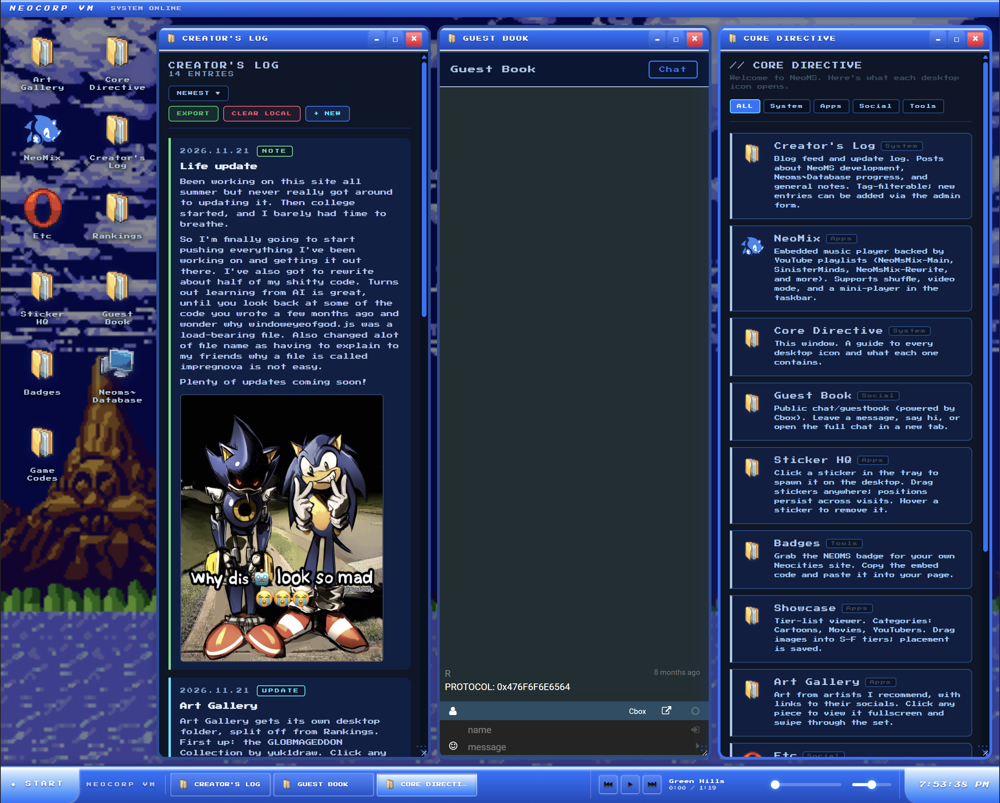
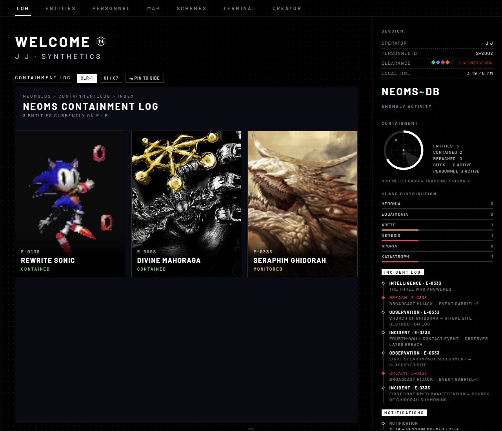

# NEOMS-CORP-WEBPAGE

> **NEO Monitoring System** — a retro-OS personal homepage and SCP-style containment database.

**[Visit the site → fatherlessjaymo.neocities.org](https://fatherlessjaymo.neocities.org)**

## PrimeDrive

My homepage, styled like a retro desktop — Creator's Log, NeoMix music player, rankings, stickers, and a guest book.

## Neoms~Database

A containment archive — browse entity files and reports, personnel records, and classification schemes, track
sites on the Global Facility Map, and dig through the archive from the Direct Access Terminal. Some files need a
higher clearance level to open. Open it from the PrimeDrive start menu.

MIT licensed — see [LICENSE](LICENSE). © 2026 FatherlessJaymo.
